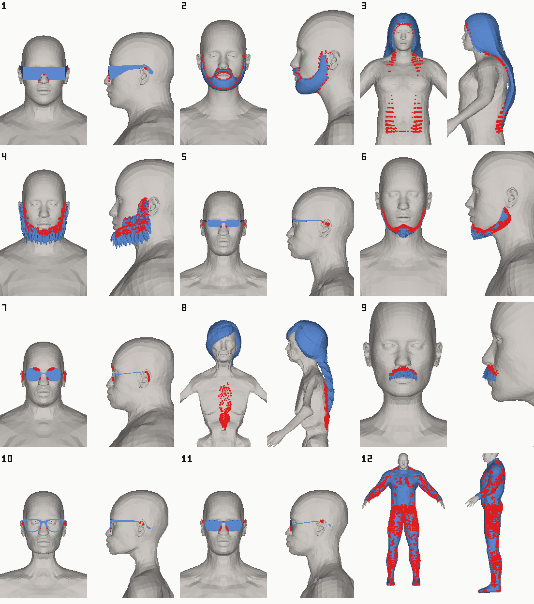

# Slider extremes sweep

Generated by `bun bin/extremes.ts` on 2026-11-02, in 34.5 min under bun 1.4.2. The numbers are in `reviews/extremes/extremes.json`. Pack: `static-assets/assets/makehuman/hm08/hm08.json` (MakeHuman a8bc2d54ff). Hair: `static-assets/derived/quaternius/libraries/hairstyles.glb`. Licences: MakeHuman asset pack metadata (source/packs/*/packs/*.json).

## What was run

133 bodies (1 default, 64 macro, 24 ancestry, 44 local; the subset and why are in `src/extremes-corners.ts`), each wearing every item below alone: 131 MakeHuman garments and 43 hair, brow and beard pieces (MakeHuman proxies through proxy-fit, Quaternius styles through hair-fit), fitted as the character builder fits them.

Every fitted vertex was put to a signed-distance inside test against the bare skin (nearest triangle through a grid, signed by the angle-weighted pseudo-normal, with a three-ray parity vote beyond 2 cm; the body mesh has 0 open edges). A vertex is **visibly** inside when it is deeper than the character builder tucks the skin there (coverBody's 6 mm for listed skin, 4-10 mm under a wrapping garment), by more than 1 mm. An item **fails** on a body when more than 0.20% of its vertices, and more than 3, are visibly inside.

Not covered: layering (two garments on one body), posed bodies (everything is at the rest pose, so a sleeve through a bent elbow is not seen), and Quaternius' brows. The tuck is reproduced without coverBody's fade at the edge of the covered patch, so it is a little generous at the edges. No skin is tucked under hair, so a hair vertex inside the skin counts wherever it is: a style modelled with an inner layer under the scalp scores worse than it looks. Depths are measured to 30 mm; deeper reads 30+.

## Results

- **Hold up** on every body: 68 of 174 items (45 of 131 garments).
- **Fail at the extremes** (fine on the default body): 58.
- **Broken at the default body** already: 48.
- **Bones:** no issues on any body; 8 joints sit outside the skin on the default body already (baseline, not flagged again).

## Starter-wardrobe candidates

CC0 garments that hold up on every swept body, by slot: the pool to choose the starter wardrobe from (the twelve are not chosen here). Each was worn alone; check pairs before shipping a look.

- **bodysuit** (2): `matcreator_mc-bodysuit-2021`, `matcreator_mc-skinsuit_2022`
- **bottom** (3): `frankyaye_mini_skirt_01`, `frankyaye_mini_skirt_02`, `rehmanpolanski_viking_pants`
- **gloves** (6): `culturalibre_hero-heroine_gloves_2`, `culturalibre_hero-heroine_gloves_3`, `culturalibre_hero-heroine_gloves_4`, `learning_mma_fighting_gloves`, `toigo_gloves_long`, `toigo_gloves_short`
- **hat** (9): `fedora01`, `fedora_cocked`, `aethelraed_unraed_cloche_hat`, `grinsegold_uncle_joshis_hat`, `joepal_xmas_cap`, `jujube_newsboy_cap`, `culturalibre_warrior_helmet`, `grinsegold_corinthian_helmet`, `javherre_casco_caballero_templario_templar_knight_helmet`
- **mask** (3): `culturalibre_hero-heroine_hood_1`, `culturalibre_hero_mask_4`, `culturalibre_heroine_mask_1`
- **outfit** (8): `male_casualsuit02`, `male_worksuit01`, `toigo_suit_with_dinner_jacket`, `culturalibre_hero_suit_1`, `culturalibre_hero_suit_2`, `culturalibre_hero_suit_3`, `culturalibre_heroine_suit_2`, `green_tomato_rei_ayanami`
- **shoes** (11): `cortu_floppy_overknee_shoes`, `cortu_t-bar`, `culturalibre_hero_boots_1`, `culturalibre_hero_boots_2`, `culturalibre_hero_boots_4`, `culturalibre_hero_boots_5`, `culturalibre_heroine_boots_2`, `culturalibre_heroine_boots_3`, `toigo_flats`, `toigo_mj_cloth_shoes`, `rehmanpolanski_viking_boots`
- **top** (3): `elvs_crude_t-shirt_male`, `joepal_crude_t-shirt_female`, `toigo_bodice-style_top`

Near misses (CC0 or not), failing on at most 5% of bodies, a likely fix away: `male_casualsuit03` (1, worst female, min, min, short, uncommon), `scailman_semitransparent_water_boots` (1, worst male, old (90), max, max, tall, ideal), `joepal_medical_mouth_protection` (1, worst female, min, min, af 0, as 1, ca 0), `toigo_fisherman_sweater` (2, worst female, max, bust 1), `toigo_male_suit_3` (3, worst male, min, min, af 1, as 0, ca 0), `toigo_male_suit_tie_and_jacket` (3, worst male, min, min, short, uncommon), `toigo_suit_with_jacket_and_bowtie` (4, worst male, min, min, short, uncommon), `skalldyrssuppe_tube_top_funky_colors` (5, worst female, min, bust 1), `green_tomato_yoko_tsuno` (5, worst male, max, min, short, uncommon).

## Garments

| Item | Slot | Licence | Verts | Verdict | Fails on | At default | Worst body | Worst visible | Deepest |
| --- | --- | --- | ---: | --- | ---: | ---: | --- | ---: | ---: |
| `fedora01` | hat | CC0-1.0 | 634 | holds | 0/133 | 0 | default | 0 (0.00%) | 0.0 mm |
| `fedora_cocked` | hat | CC0-1.0 | 634 | holds | 0/133 | 0 | default | 0 (0.00%) | 0.0 mm |
| `joepal_crude_t-shirt_female` | top | CC0-1.0 | 1095 | holds | 0/133 | 0 | default | 0 (0.00%) | 0.0 mm |
| `toigo_bodice-style_top` | top | CC0-1.0 | 1017 | holds | 0/133 | 0 | default | 0 (0.00%) | 0.0 mm |
| `frankyaye_mini_skirt_02` | bottom | CC0-1.0 | 1385 | holds | 0/133 | 0 | default | 0 (0.00%) | 0.0 mm |
| `cortu_floppy_overknee_shoes` | shoes | CC0-1.0 | 1586 | holds | 0/133 | 0 | default | 0 (0.00%) | 0.0 mm |
| `cortu_t-bar` | shoes | CC0-1.0 | 392 | holds | 0/133 | 0 | default | 0 (0.00%) | 0.0 mm |
| `culturalibre_hero_boots_1` | shoes | CC0-1.0 | 1448 | holds | 0/133 | 0 | default | 0 (0.00%) | 0.0 mm |
| `culturalibre_hero_boots_2` | shoes | CC0-1.0 | 1160 | holds | 0/133 | 0 | default | 0 (0.00%) | 0.0 mm |
| `culturalibre_hero_boots_4` | shoes | CC0-1.0 | 1160 | holds | 0/133 | 0 | default | 0 (0.00%) | 0.0 mm |
| `culturalibre_heroine_boots_2` | shoes | CC0-1.0 | 1364 | holds | 0/133 | 0 | default | 0 (0.00%) | 0.0 mm |
| `culturalibre_heroine_boots_3` | shoes | CC0-1.0 | 1364 | holds | 0/133 | 0 | default | 0 (0.00%) | 0.0 mm |
| `toigo_mj_cloth_shoes` | shoes | CC0-1.0 | 556 | holds | 0/133 | 0 | default | 0 (0.00%) | 0.0 mm |
| `aethelraed_unraed_cloche_hat` | hat | CC0-1.0 | 441 | holds | 0/133 | 0 | default | 0 (0.00%) | 0.0 mm |
| `joepal_xmas_cap` | hat | CC0-1.0 | 1042 | holds | 0/133 | 0 | default | 0 (0.00%) | 0.0 mm |
| `jujube_newsboy_cap` | hat | CC0-1.0 | 517 | holds | 0/133 | 0 | default | 0 (0.00%) | 0.0 mm |
| `culturalibre_hero-heroine_gloves_2` | gloves | CC0-1.0 | 7236 | holds | 0/133 | 0 | default | 0 (0.00%) | 0.0 mm |
| `culturalibre_hero-heroine_gloves_3` | gloves | CC0-1.0 | 7272 | holds | 0/133 | 0 | default | 0 (0.00%) | 0.0 mm |
| `culturalibre_hero-heroine_gloves_4` | gloves | CC0-1.0 | 8276 | holds | 0/133 | 0 | default | 0 (0.00%) | 0.0 mm |
| `learning_mma_fighting_gloves` | gloves | CC0-1.0 | 2740 | holds | 0/133 | 0 | default | 0 (0.00%) | 0.0 mm |
| `toigo_gloves_short` | gloves | CC0-1.0 | 2294 | holds | 0/133 | 0 | default | 0 (0.00%) | 0.0 mm |
| `culturalibre_hero_suit_3` | outfit | CC0-1.0 | 14616 | holds | 0/133 | 0 | default | 0 (0.00%) | 0.0 mm |
| `matcreator_mc-bodysuit-2021` | bodysuit | CC0-1.0 | 27871 | holds | 0/133 | 0 | default | 0 (0.00%) | 0.0 mm |
| `matcreator_mc-skinsuit_2022` | bodysuit | CC0-1.0 | 9848 | holds | 0/133 | 0 | default | 0 (0.00%) | 0.0 mm |
| `culturalibre_warrior_helmet` | hat | CC0-1.0 | 1322 | holds | 0/133 | 0 | default | 0 (0.00%) | 0.0 mm |
| `grinsegold_corinthian_helmet` | hat | CC0-1.0 | 166 | holds | 0/133 | 0 | default | 0 (0.00%) | 0.0 mm |
| `javherre_casco_caballero_templario_templar_knight_helmet` | hat | CC0-1.0 | 3218 | holds | 0/133 | 0 | default | 0 (0.00%) | 0.0 mm |
| `culturalibre_hero-heroine_hood_1` | mask | CC0-1.0 | 1502 | holds | 0/133 | 0 | default | 0 (0.00%) | 0.0 mm |
| `culturalibre_heroine_mask_1` | mask | CC0-1.0 | 2462 | holds | 0/133 | 0 | default | 0 (0.00%) | 0.0 mm |
| `culturalibre_heroine_suit_2` | outfit | CC0-1.0 | 7096 | holds | 0/133 | 0 | g1-a1-m0-w1-h0-p1 | 2 (0.03%) | 1.3 mm |
| `male_worksuit01` | outfit | CC0-1.0 | 3763 | holds | 0/133 | 2 | default | 2 (0.05%) | 1.2 mm |
| `toigo_gloves_long` | gloves | CC0-1.0 | 3454 | holds | 0/133 | 0 | g1-m1-w1-h0-p1 | 2 (0.06%) | 1.3 mm |
| `culturalibre_hero_suit_1` | outfit | CC0-1.0 | 7724 | holds | 0/133 | 0 | g0-m0-w0-h0-p1 | 6 (0.08%) | 5.5 mm |
| `rehmanpolanski_viking_boots` | shoes | CC0-1.0 | 3196 | holds | 0/133 | 3 | default | 3 (0.09%) | 2.6 mm |
| `culturalibre_hero_suit_2` | outfit | CC0-1.0 | 5652 | holds | 0/133 | 0 | g0-m0-w0-h0-p0 | 6 (0.11%) | 7.1 mm |
| `grinsegold_uncle_joshis_hat` | hat | CC0-1.0 | 3588 | holds | 0/133 | 0 | g1-m0-w0-h1-p0 | 4 (0.11%) | 1.7 mm |
| `toigo_suit_with_dinner_jacket` | outfit | CC0-1.0 | 8069 | holds | 0/133 | 0 | g0-m1-w1-af1-as0-ca0 | 9 (0.11%) | 4.3 mm |
| `green_tomato_rei_ayanami` | outfit | CC0-1.0 | 5698 | holds | 0/133 | 0 | g1-a1-m1-w1-h1-p0 | 7 (0.12%) | 3.3 mm |
| `toigo_flats` | shoes | CC0-1.0 | 28808 | holds | 0/133 | 0 | g1-a1-m0-w1-h1-p0 | 38 (0.13%) | 2.8 mm |
| `culturalibre_hero_boots_5` | shoes | CC0-1.0 | 5780 | holds | 0/133 | 0 | g1-m0-w1-h1-p0 | 10 (0.17%) | 2.3 mm |
| `elvs_crude_t-shirt_male` | top | CC0-1.0 | 1095 | holds | 0/133 | 0 | g1-a1-m0-w1-h0-p1 | 2 (0.18%) | 1.8 mm |
| `male_casualsuit02` | outfit | CC0-1.0 | 2136 | holds | 0/133 | 0 | g0-m1-w1-h0-p0 | 4 (0.19%) | 4.5 mm |
| `frankyaye_mini_skirt_01` | bottom | CC0-1.0 | 905 | holds | 0/133 | 0 | g1-a1-m0-w0-h0-p1 | 2 (0.22%) | 3.3 mm |
| `rehmanpolanski_viking_pants` | bottom | CC0-1.0 | 1312 | holds | 0/133 | 0 | g1-m1-w1-h0-p0 | 3 (0.23%) | 7.4 mm |
| `culturalibre_hero_mask_4` | mask | CC0-1.0 | 816 | holds | 0/133 | 2 | default | 2 (0.25%) | 1.3 mm |
| `scailman_semitransparent_water_boots` | shoes | CC0-1.0 | 5468 | fails-at-extremes | 1/133 | 0 | g1-a1-m1-w1-h1-p1 | 12 (0.22%) | 4.2 mm |
| `male_casualsuit03` | outfit | CC0-1.0 | 2499 | fails-at-extremes | 1/133 | 0 | g0-m0-w0-h0-p0 | 7 (0.28%) | 5.3 mm |
| `joepal_medical_mouth_protection` | mask | CC0-1.0 | 139 | fails-at-extremes | 1/133 | 2 | g0-m0-w0-af0-as1-ca0 | 4 (2.88%) | 3.2 mm |
| `toigo_fisherman_sweater` | top | CC0-1.0 | 2126 | fails-at-extremes | 2/133 | 0 | g0-w1-bust1 | 5 (0.24%) | 5.6 mm |
| `toigo_male_suit_3` | outfit | CC0-1.0 | 8527 | fails-at-extremes | 3/133 | 0 | g1-m0-w0-af1-as0-ca0 | 37 (0.43%) | 5.7 mm |
| `toigo_male_suit_tie_and_jacket` | outfit | CC0-1.0 | 9980 | fails-at-extremes | 3/133 | 0 | g1-m0-w0-h0-p0 | 45 (0.45%) | 6.8 mm |
| `toigo_suit_with_jacket_and_bowtie` | outfit | CC0-1.0 | 12849 | fails-at-extremes | 4/133 | 0 | g1-m0-w0-h0-p0 | 67 (0.52%) | 7.3 mm |
| `green_tomato_yoko_tsuno` | outfit | CC0-1.0 | 2698 | fails-at-extremes | 5/133 | 2 | g1-m1-w0-h0-p0 | 12 (0.44%) | 10.5 mm |
| `skalldyrssuppe_tube_top_funky_colors` | top | CC0-1.0 | 1456 | fails-at-extremes | 5/133 | 0 | g0-w0-bust1 | 56 (3.85%) | 10.0 mm |
| `toigo_wool_pants` | bottom | CC0-1.0 | 1372 | fails-at-extremes | 7/133 | 0 | g1-m1-w1-h0-p1 | 13 (0.95%) | 6.5 mm |
| `culturalibre_male_boots` | shoes | CC0-1.0 | 15308 | fails-at-extremes | 8/133 | 20 | g1-a1-m1-w1-h1-p1 | 62 (0.41%) | 12.0 mm |
| `namuhekam_male_polo_shirt` | top | CC0-1.0 | 2189 | fails-at-extremes | 9/133 | 0 | g1-m1-w1-h0-p1 | 13 (0.59%) | 8.8 mm |
| `shoes03` | shoes | CC0-1.0 | 2222 | fails-at-extremes | 12/133 | 0 | g0-a1-m0-w0-h0-p1 | 26 (1.17%) | 3.6 mm |
| `cortu_jeans_shorts` | bottom | CC0-1.0 | 285 | fails-at-extremes | 12/133 | 0 | g0-m0-w1-h0-p0 | 4 (1.40%) | 8.1 mm |
| `culturalibre_doc_ock_glasses` | glasses | CC0-1.0 | 10114 | fails-at-extremes | 12/133 | 0 | g1-m0-w0-af1-as0-ca0 | 173 (1.71%) | 2.5 mm |
| `cortu_cargo_pants` | bottom | CC0-1.0 | 211 | fails-at-extremes | 12/133 | 0 | g0-m0-w1-h0-p0 | 4 (1.90%) | 8.7 mm |
| `spamrakuen_sagerfrogs_glasses_04` | glasses | CC0-1.0 | 890 | fails-at-extremes | 12/133 | 0 | g1-m0-w1-af1-as0-ca0 | 44 (4.94%) | 3.5 mm |
| `toigo_keyhole_tank_top` | top | CC0-1.0 | 726 | fails-at-extremes | 13/133 | 0 | g1-m0-w1-h0-p0 | 11 (1.52%) | 4.8 mm |
| `shoes01` | shoes | CC0-1.0 | 1722 | fails-at-extremes | 14/133 | 0 | g0-a1-m0-w0-h0-p1 | 26 (1.51%) | 3.6 mm |
| `shoes04` | shoes | CC0-1.0 | 1722 | fails-at-extremes | 14/133 | 0 | g0-a1-m0-w0-h0-p1 | 26 (1.51%) | 3.6 mm |
| `shoes02` | shoes | CC0-1.0 | 1594 | fails-at-extremes | 14/133 | 0 | g0-a1-m0-w0-h0-p1 | 26 (1.63%) | 3.6 mm |
| `shoes05` | shoes | CC0-1.0 | 1594 | fails-at-extremes | 14/133 | 0 | g0-a1-m0-w0-h0-p1 | 26 (1.63%) | 3.6 mm |
| `shoes06` | shoes | CC0-1.0 | 1594 | fails-at-extremes | 14/133 | 0 | g0-a1-m0-w0-h0-p1 | 26 (1.63%) | 3.6 mm |
| `toigo_tiered_mini_skirt` | bottom | CC0-1.0 | 5472 | fails-at-extremes | 16/133 | 4 | g1-a1-m1-w0-h0-p0 | 130 (2.38%) | 9.4 mm |
| `male_casualsuit04` | outfit | CC0-1.0 | 1696 | fails-at-extremes | 17/133 | 0 | g1-m1-w1-h0-p0 | 10 (0.59%) | 9.8 mm |
| `culturalibre_motorcycle_helmet` | hat | CC0-1.0 | 22306 | fails-at-extremes | 22/133 | 0 | g0-m1-w1-h0-p0 | 451 (2.02%) | 15.1 mm |
| `toigo_ankle_boots_male` | shoes | CC0-1.0 | 2084 | fails-at-extremes | 22/133 | 0 | g0-a1-m0-w0-h0-p1 | 63 (3.02%) | 4.9 mm |
| `toigo_female_suit` | outfit | CC0-1.0 | 14396 | fails-at-extremes | 25/133 | 0 | g1-m0-w0-h0-p0 | 160 (1.11%) | 15.4 mm |
| `toigo_ankle_boots_female` | shoes | CC0-1.0 | 2084 | fails-at-extremes | 26/133 | 0 | g0-a1-m0-w0-h1-p1 | 80 (3.84%) | 5.7 mm |
| `male_elegantsuit01` | outfit | CC0-1.0 | 7613 | fails-at-extremes | 27/133 | 9 | g1-m0-w0-h0-p0 | 40 (0.53%) | 7.5 mm |
| `toigo_female_suit_2` | outfit | CC0-1.0 | 8509 | fails-at-extremes | 27/133 | 0 | g1-m1-w0-h0-p0 | 112 (1.32%) | 9.2 mm |
| `toigo_tiered_skirt` | bottom | CC0-1.0 | 6552 | fails-at-extremes | 28/133 | 0 | g0-a1-m0-w1-h1-p0 | 85 (1.30%) | 7.9 mm |
| `culturalibre_hero-heroine_gloves_1` | gloves | CC0-1.0 | 2268 | fails-at-extremes | 30/133 | 2 | g1-m1-w0-h1-p0 | 18 (0.79%) | 5.4 mm |
| `male_casualsuit06` | outfit | CC0-1.0 | 3708 | fails-at-extremes | 31/133 | 3 | g1-m1-w1-h0-p0 | 25 (0.67%) | 19.3 mm |
| `spamrakuen_tbm_glasses_frames_01` | glasses | CC0-1.0 | 406 | fails-at-extremes | 32/133 | 0 | g1-m0-w0-af1-as0-ca0 | 32 (7.88%) | 4.7 mm |
| `culturalibre_hero-heroine_gloves_5` | gloves | CC0-1.0 | 2628 | fails-at-extremes | 38/133 | 2 | g1-m0-w0-h1-p0 | 28 (1.07%) | 4.2 mm |
| `toigo_camisole_top` | top | CC0-1.0 | 4224 | fails-at-extremes | 39/133 | 0 | g1-a1-m1-w0-h0-p1 | 83 (1.96%) | 4.9 mm |
| `toigo_harem_pants` | bottom | CC0-1.0 | 5527 | fails-at-extremes | 40/133 | 6 | g1-m1-w1-h0-p1 | 147 (2.66%) | 30+ mm |
| `toigo_ballet_flats_with_bows` | shoes | CC0-1.0 | 7756 | fails-at-extremes | 44/133 | 0 | g1-a1-m0-w1-h0-p0 | 238 (3.07%) | 6.5 mm |
| `toigo_ballet_flats_with_flowers` | shoes | CC0-1.0 | 5340 | fails-at-extremes | 44/133 | 0 | g1-a1-m0-w1-h0-p0 | 238 (4.46%) | 6.5 mm |
| `toigo_ballet_flats` | shoes | CC0-1.0 | 4558 | fails-at-extremes | 44/133 | 0 | g1-a1-m0-w1-h0-p0 | 238 (5.22%) | 6.5 mm |
| `donitz_monk_robe_hood_down` | hat | CC0-1.0 | 4505 | broken-at-default | 46/133 | 10 | g1-a1-m0-w1-h0-p1 | 93 (2.06%) | 5.9 mm |
| `toigo_female_double-breasted_suit` | outfit | CC0-1.0 | 5393 | fails-at-extremes | 49/133 | 6 | g0-m1-w1-af1-as0-ca0 | 32 (0.59%) | 8.6 mm |
| `toigo_basic_tucked_t-shirt` | top | CC0-1.0 | 1391 | fails-at-extremes | 49/133 | 3 | g0-m0-w0-h1-p0 | 11 (0.79%) | 2.3 mm |
| `toigo_stiletto_booties` | shoes | CC0-1.0 | 22414 | fails-at-extremes | 53/133 | 38 | g0-a1-m0-w0-h0-p1 | 588 (2.62%) | 6.4 mm |
| `kwnet_at_optical_glasses` | glasses | CC0-1.0 | 3138 | fails-at-extremes | 54/133 | 1 | g1-m1-w0-af1-as0-ca0 | 236 (7.52%) | 3.7 mm |
| `female_elegantsuit01` | outfit | CC0-1.0 | 2205 | fails-at-extremes | 56/133 | 1 | g0-m0-w1-h1-p1 | 18 (0.82%) | 10.2 mm |
| `toigo_gloves_medium` | gloves | CC0-1.0 | 2894 | fails-at-extremes | 58/133 | 2 | g0-m0-w0-h1-p0 | 10 (0.35%) | 2.9 mm |
| `joachip_cyborg_suit` | outfit | CC0-1.0 | 944 | fails-at-extremes | 65/133 | 2 | g0-m0-w1-h1-p0 | 20 (2.12%) | 30+ mm |
| `spamrakuen_sagerfrogs_glasses_03` | glasses | CC0-1.0 | 1664 | broken-at-default | 75/133 | 6 | g1-m0-w1-h0-p0 | 100 (6.01%) | 2.5 mm |
| `jujube_bag_on_head` | hat | CC0-1.0 | 5665 | broken-at-default | 77/133 | 55 | g1-m0-w0-h0-p1 | 121 (2.14%) | 21.9 mm |
| `toigo_long_full_skirt` | bottom | CC0-1.0 | 2992 | broken-at-default | 77/133 | 14 | g1-m1-w0-h0-p1 | 149 (4.98%) | 5.7 mm |
| `spamrakuen_sagerfrogs_glasses_01` | glasses | CC0-1.0 | 660 | broken-at-default | 81/133 | 4 | g1-m0-w1-af1-as0-ca0 | 36 (5.45%) | 4.4 mm |
| `toigo_skirt_with_lace_ruffle` | bottom | CC0-1.0 | 2856 | broken-at-default | 82/133 | 14 | g1-m1-w0-h0-p1 | 146 (5.11%) | 5.7 mm |
| `male_casualsuit05` | outfit | CC0-1.0 | 3195 | broken-at-default | 85/133 | 12 | g0-m1-w1-h1-p0 | 16 (0.50%) | 10.5 mm |
| `culturalibre_heroine_boots_1` | shoes | CC0-1.0 | 2056 | broken-at-default | 85/133 | 8 | g0-m0-w0-h1-p0 | 12 (0.58%) | 2.9 mm |
| `culturalibre_hero_mask_3` | mask | CC0-1.0 | 1034 | broken-at-default | 87/133 | 6 | g0-a1-m0-w0-h0-p0 | 14 (1.35%) | 3.0 mm |
| `toigo_round_glasses_leopard` | glasses | CC0-1.0 | 4008 | broken-at-default | 91/133 | 24 | g1-m0-w1-af1-as0-ca0 | 556 (13.87%) | 4.2 mm |
| `toigo_male_double-breasted_suit` | outfit | CC0-1.0 | 5393 | broken-at-default | 104/133 | 21 | g1-a1-m0-w1-h1-p1 | 45 (0.83%) | 18.3 mm |
| `toigo_turtleneck_halter_top` | top | CC0-1.0 | 2875 | broken-at-default | 106/133 | 15 | g1-m0-w0-af0-as1-ca0 | 44 (1.53%) | 16.9 mm |
| `male_casualsuit01` | outfit | CC0-1.0 | 8426 | broken-at-default | 118/133 | 29 | g1-m0-w0-af0-as0-ca1 | 58 (0.69%) | 16.0 mm |
| `culturalibre_hero_boots_3` | shoes | CC0-1.0 | 1160 | broken-at-default | 119/133 | 8 | g0-m0-w1-h1-p0 | 10 (0.86%) | 5.8 mm |
| `slayer227_spider-gwen` | outfit | CC0-1.0 | 21398 | fails-at-extremes | 122/133 | 9 | g1-a1-m1-w1-h1-p1 | 1582 (7.39%) | 15.8 mm |
| `culturalibre_hero_mask_1` | mask | CC0-1.0 | 2450 | broken-at-default | 125/133 | 6 | g0-m0-w0-h0-p0 | 8 (0.33%) | 1.7 mm |
| `culturalibre_hero_mask_5` | mask | CC-BY | 12984 | broken-at-default | 125/133 | 38 | g1-a1-m1-w0-h1-p0 | 94 (0.72%) | 2.6 mm |
| `culturalibre_hero_mask_2` | mask | CC0-1.0 | 27836 | broken-at-default | 125/133 | 141 | g0-a1-m0-w0-h1-p0 | 205 (0.74%) | 4.9 mm |
| `grinsegold_female_pirate_boots` | shoes | CC0-1.0 | 31862 | broken-at-default | 125/133 | 142 | g1-m1-w1-h1-p0 | 346 (1.09%) | 30+ mm |
| `spamrakuen_sagerfrogs_glasses_02` | glasses | CC0-1.0 | 752 | broken-at-default | 130/133 | 38 | g1-m1-w0-af1-as0-ca0 | 132 (17.55%) | 6.0 mm |
| `female_casualsuit02` | top | CC0-1.0 | 2876 | broken-at-default | 131/133 | 22 | g0-m1-w1-h0-p1 | 48 (1.67%) | 6.1 mm |
| `female_casualsuit01` | outfit | CC0-1.0 | 2197 | broken-at-default | 131/133 | 22 | g0-a1-m0-w0-h1-p0 | 45 (2.05%) | 13.4 mm |
| `female_sportsuit01` | outfit | CC0-1.0 | 1797 | broken-at-default | 131/133 | 22 | g0-a1-m0-w1-h1-p1 | 44 (2.45%) | 10.7 mm |
| `culturalibre_hero-heroine_hood_2` | mask | CC0-1.0 | 1966 | broken-at-default | 133/133 | 23 | g1-m0-w1-h1-p0 | 26 (1.32%) | 2.8 mm |
| `rehmanpolanski_viking_tunic` | top | CC0-1.0 | 3346 | broken-at-default | 133/133 | 26 | g1-m0-w1-h1-p1 | 50 (1.49%) | 26.8 mm |
| `mrgreaterthan_m1_helmet` | hat | CC0-1.0 | 34680 | broken-at-default | 133/133 | 547 | g1-m0-w0-h1-p0 | 594 (1.71%) | 12.9 mm |
| `scailman_gogo_platform_boots` | shoes | CC0-1.0 | 5196 | broken-at-default | 133/133 | 73 | g0-m0-w0-h1-p0 | 99 (1.91%) | 30+ mm |
| `matcreator_mc-scifi-armor_guardian` | armour | CC0-1.0 | 10731 | broken-at-default | 133/133 | 149 | g1-m1-w0-af1-as0-ca0 | 228 (2.12%) | 5.9 mm |
| `frankyaye_glasses_library_male` | glasses | CC0-1.0 | 816 | broken-at-default | 133/133 | 12 | g0-m0-w0-h1-p0 | 18 (2.21%) | 2.9 mm |
| `matcreator_mc-scifi-armor_jupiter7` | armour | CC0-1.0 | 16060 | broken-at-default | 133/133 | 179 | g1-m1-w1-h0-p1 | 463 (2.88%) | 24.5 mm |
| `donitz_monk_robe_hood_off` | hat | CC0-1.0 | 4536 | broken-at-default | 133/133 | 73 | g1-a1-m0-w0-h0-p1 | 134 (2.95%) | 15.5 mm |
| `culturalibre_heroine_boots_4` | shoes | CC-BY | 852 | broken-at-default | 133/133 | 32 | default | 32 (3.76%) | 14.7 mm |
| `donitz_monk_robe_hood` | hat | CC0-1.0 | 4504 | broken-at-default | 133/133 | 36 | g1-a1-m0-w1-h0-p0 | 249 (5.53%) | 15.9 mm |
| `thegreatengineer_galactic_warrior_uniform` | outfit | CC0-1.0 | 5290 | broken-at-default | 133/133 | 93 | g0-a1-m0-w1-h1-p1 | 295 (5.58%) | 16.2 mm |
| `donitz_monk_robe` | outfit | CC0-1.0 | 10233 | broken-at-default | 133/133 | 458 | g1-a1-m0-w1-h1-p1 | 614 (6.00%) | 30+ mm |
| `culturalibre_skull_helmet` | hat | CC0-1.0 | 4254 | broken-at-default | 133/133 | 160 | g1-a1-m1-w1-h0-p1 | 289 (6.79%) | 30+ mm |
| `matcreator_mc-scifi-armor_helios` | armour | CC0-1.0 | 82891 | broken-at-default | 133/133 | 4621 | g1-a1-m0-w0-h0-p0 | 5659 (6.83%) | 6.2 mm |
| `ews_3d_glasses` | glasses | CC0-1.0 | 72 | broken-at-default | 133/133 | 9 | g1-m0-w1-h1-p0 | 18 (25.00%) | 3.4 mm |

## Hair, brows and beards

| Item | Slot | Licence | Verts | Verdict | Fails on | At default | Worst body | Worst visible | Deepest |
| --- | --- | --- | ---: | --- | ---: | ---: | --- | ---: | ---: |
| `short03` | hair | CC0-1.0 | 1011 | holds | 0/133 | 0 | default | 0 (0.00%) | 0.0 mm |
| `eyebrow001` | brows | CC0-1.0 | 124 | holds | 0/133 | 0 | default | 0 (0.00%) | 0.0 mm |
| `eyebrow002` | brows | CC0-1.0 | 124 | holds | 0/133 | 0 | default | 0 (0.00%) | 0.0 mm |
| `eyebrow006` | brows | CC0-1.0 | 124 | holds | 0/133 | 0 | default | 0 (0.00%) | 0.0 mm |
| `eyebrow007` | brows | CC0-1.0 | 124 | holds | 0/133 | 0 | default | 0 (0.00%) | 0.0 mm |
| `eyebrow009` | brows | CC0-1.0 | 124 | holds | 0/133 | 0 | default | 0 (0.00%) | 0.0 mm |
| `eyebrow010` | brows | CC0-1.0 | 124 | holds | 0/133 | 0 | default | 0 (0.00%) | 0.0 mm |
| `Hair_Balding` | hair | CC0-1.0 | 932 | holds | 0/133 | 0 | default | 0 (0.00%) | 0.0 mm |
| `Hair_Bob` | hair | CC0-1.0 | 3796 | holds | 0/133 | 0 | default | 0 (0.00%) | 0.0 mm |
| `Hair_Buzzed` | hair | CC0-1.0 | 466 | holds | 0/133 | 0 | default | 0 (0.00%) | 0.0 mm |
| `Hair_BuzzedFemale` | hair | CC0-1.0 | 466 | holds | 0/133 | 0 | default | 0 (0.00%) | 0.0 mm |
| `Hair_Dreads` | hair | CC0-1.0 | 3274 | holds | 0/133 | 0 | default | 0 (0.00%) | 0.0 mm |
| `Hair_Mohawk` | hair | CC0-1.0 | 1542 | holds | 0/133 | 0 | default | 0 (0.00%) | 0.0 mm |
| `Hair_Ponytail` | hair | CC0-1.0 | 1560 | holds | 0/133 | 0 | default | 0 (0.00%) | 0.0 mm |
| `Hair_SimpleParted` | hair | CC0-1.0 | 757 | holds | 0/133 | 0 | default | 0 (0.00%) | 0.0 mm |
| `Hair_SlickBack` | hair | CC0-1.0 | 985 | holds | 0/133 | 0 | default | 0 (0.00%) | 0.0 mm |
| `Hair_LongDreads` | hair | CC0-1.0 | 5266 | holds | 0/133 | 0 | g1-a1-m0-w1-h0-p0 | 1 (0.02%) | 3.0 mm |
| `Hair_Buns` | hair | CC0-1.0 | 3502 | holds | 0/133 | 0 | g0-m0-w0-h1-p0 | 2 (0.06%) | 1.8 mm |
| `Hair_Ponytail_2` | hair | CC0-1.0 | 2374 | holds | 0/133 | 0 | g0-m0-w1-af0-as1-ca0 | 2 (0.08%) | 1.7 mm |
| `Hair_Long` | hair | CC0-1.0 | 3080 | holds | 0/133 | 0 | g0-m0-w0-h0-p0 | 4 (0.13%) | 2.2 mm |
| `ponytail01` | hair | CC0-1.0 | 3718 | holds | 0/133 | 4 | g0-m0-w0-h1-p0 | 5 (0.13%) | 3.5 mm |
| `eyebrow004` | brows | CC0-1.0 | 124 | holds | 0/133 | 0 | g1-m0-w0-h1-p0 | 2 (1.61%) | 1.1 mm |
| `eyebrow008` | brows | CC0-1.0 | 124 | holds | 0/133 | 0 | g1-m0-w0-h1-p0 | 2 (1.61%) | 1.0 mm |
| `short01` | hair | CC0-1.0 | 2984 | fails-at-extremes | 4/133 | 3 | g1-m1-w0-h1-p0 | 6 (0.20%) | 1.5 mm |
| `Hair_Moustache` | beard | CC0-1.0 | 243 | fails-at-extremes | 5/133 | 0 | g0-m0-w0-h0-p0 | 6 (2.47%) | 3.1 mm |
| `eyebrow011` | brows | CC0-1.0 | 124 | fails-at-extremes | 8/133 | 2 | g0-m0-w0-af0-as1-ca0 | 4 (3.23%) | 1.3 mm |
| `Hair_MuttonChops` | beard | CC0-1.0 | 567 | fails-at-extremes | 11/133 | 0 | g0-m0-w0-h0-p0 | 26 (4.59%) | 8.1 mm |
| `Hair_Beard` | beard | CC0-1.0 | 596 | fails-at-extremes | 12/133 | 0 | g0-m0-w0-h0-p0 | 16 (2.68%) | 4.6 mm |
| `eyebrow003` | brows | CC0-1.0 | 124 | fails-at-extremes | 26/133 | 0 | g1-m0-w0-h1-p0 | 6 (4.84%) | 1.1 mm |
| `short04` | hair | CC0-1.0 | 865 | fails-at-extremes | 32/133 | 3 | g0-m0-w0-h1-p0 | 4 (0.46%) | 2.6 mm |
| `eyebrow012` | brows | CC0-1.0 | 124 | fails-at-extremes | 58/133 | 2 | g0-m0-w0-h1-p0 | 4 (3.23%) | 1.2 mm |
| `eyebrow005` | brows | CC0-1.0 | 124 | broken-at-default | 82/133 | 4 | g0-m0-w1-h1-p0 | 8 (6.45%) | 1.5 mm |
| `braid01` | hair | CC0-1.0 | 4493 | fails-at-extremes | 96/133 | 4 | g0-a1-m0-w0-h0-p1 | 607 (13.51%) | 16.1 mm |
| `short02` | hair | CC0-1.0 | 1755 | broken-at-default | 133/133 | 7 | g0-m0-w0-h1-p0 | 9 (0.51%) | 2.7 mm |
| `afro01` | hair | CC0-1.0 | 2196 | broken-at-default | 133/133 | 34 | g0-m1-w1-h1-p0 | 39 (1.78%) | 9.3 mm |
| `bob01` | hair | CC0-1.0 | 5203 | broken-at-default | 133/133 | 80 | g0-m1-w1-af0-as1-ca0 | 192 (3.69%) | 25.6 mm |
| `rehmanpolanski_beard_viking` | beard | CC0-1.0 | 6557 | broken-at-default | 133/133 | 183 | g1-a1-m0-w1-h0-p0 | 244 (3.72%) | 9.7 mm |
| `bob02` | hair | CC0-1.0 | 1653 | broken-at-default | 133/133 | 71 | g0-m0-w0-af0-as1-ca0 | 91 (5.51%) | 30+ mm |
| `rehmanpolanski_moustache_viking` | beard | CC0-1.0 | 1598 | broken-at-default | 133/133 | 158 | g1-m0-w0-h1-p0 | 174 (10.89%) | 5.6 mm |
| `culturalibre_faun_beard` | beard | CC0-1.0 | 5218 | broken-at-default | 133/133 | 587 | g1-m1-w0-h1-p0 | 893 (17.11%) | 5.0 mm |
| `wdg_scruffy_beard` | beard | CC0-1.0 | 2300 | broken-at-default | 133/133 | 411 | g1-m0-w1-h1-p0 | 445 (19.35%) | 14.2 mm |
| `long01` | hair | CC0-1.0 | 3239 | broken-at-default | 133/133 | 148 | g1-w1-chest1-pecs1-waist1-bust1 | 643 (19.85%) | 30+ mm |
| `grinsegold_beard_sigmund_wip` | beard | CC0-1.0 | 503 | broken-at-default | 133/133 | 96 | g0-m0-w1-h1-p0 | 103 (20.48%) | 9.5 mm |

## Worst cases

The contact sheet (drawn headless by `src/extremes-sheet.ts`): each case is the item on the body it fails worst on, at the rest pose, from the front and from the left; the body grey, the item blue, and red where the item is visibly inside the skin (drawn over everything, so it shows from behind too).

1. `makehuman:proxy/ews_3d_glasses` on g1-m0-w1-h1-p0 (male, min, max, tall, uncommon)
2. `makehuman:proxy/grinsegold_beard_sigmund_wip` on g0-m1-w0-h1-p0 (female, max, min, tall, uncommon)
3. `makehuman:proxy/long01` on g1-w1-chest1-pecs1-waist1-bust1 (male, max, chest 1, pecs 1, waist 1, bust 1)
4. `makehuman:proxy/wdg_scruffy_beard` on g1-m0-w1-h1-p0 (male, min, max, tall, uncommon)
5. `makehuman:proxy/spamrakuen_sagerfrogs_glasses_02` on g1-m1-w0-af1-as0-ca0 (male, max, min, af 1, as 0, ca 0)
6. `makehuman:proxy/culturalibre_faun_beard` on g1-m1-w0-h1-p0 (male, max, min, tall, uncommon)
7. `makehuman:proxy/toigo_round_glasses_leopard` on g1-m0-w1-af1-as0-ca0 (male, min, max, af 1, as 0, ca 0)
8. `makehuman:proxy/braid01` on g0-a1-m0-w0-h0-p1 (female, old (90), min, min, short, ideal)
9. `makehuman:proxy/rehmanpolanski_moustache_viking` on g1-m0-w0-h1-p0 (male, min, min, tall, uncommon)
10. `makehuman:proxy/spamrakuen_tbm_glasses_frames_01` on g1-m0-w0-af1-as0-ca0 (male, min, min, af 1, as 0, ca 0)
11. `makehuman:proxy/kwnet_at_optical_glasses` on g1-m1-w0-af1-as0-ca0 (male, max, min, af 1, as 0, ca 0)
12. `makehuman:proxy/slayer227_spider-gwen` on g1-a1-m1-w1-h1-p1 (male, old (90), max, max, tall, ideal)

| Item | Body | Visible | Of its vertices | Deepest beyond tuck |
| --- | --- | ---: | ---: | ---: |
| `makehuman:proxy/ews_3d_glasses` | g1-m0-w1-h1-p0 (male, min, max, tall, uncommon) | 18 | 25.00% | 3.4 mm |
| `makehuman:proxy/grinsegold_beard_sigmund_wip` | g0-m1-w0-h1-p0 (female, max, min, tall, uncommon) | 103 | 20.48% | 9.5 mm |
| `makehuman:proxy/long01` | g1-w1-chest1-pecs1-waist1-bust1 (male, max, chest 1, pecs 1, waist 1, bust 1) | 643 | 19.85% | 30+ mm |
| `makehuman:proxy/wdg_scruffy_beard` | g1-m0-w1-h1-p0 (male, min, max, tall, uncommon) | 445 | 19.35% | 14.2 mm |
| `makehuman:proxy/spamrakuen_sagerfrogs_glasses_02` | g1-m1-w0-af1-as0-ca0 (male, max, min, af 1, as 0, ca 0) | 132 | 17.55% | 6.0 mm |
| `makehuman:proxy/culturalibre_faun_beard` | g1-m1-w0-h1-p0 (male, max, min, tall, uncommon) | 893 | 17.11% | 5.0 mm |
| `makehuman:proxy/toigo_round_glasses_leopard` | g1-m0-w1-af1-as0-ca0 (male, min, max, af 1, as 0, ca 0) | 556 | 13.87% | 4.2 mm |
| `makehuman:proxy/braid01` | g0-a1-m0-w0-h0-p1 (female, old (90), min, min, short, ideal) | 607 | 13.51% | 16.1 mm |
| `makehuman:proxy/rehmanpolanski_moustache_viking` | g1-m0-w0-h1-p0 (male, min, min, tall, uncommon) | 174 | 10.89% | 5.6 mm |
| `makehuman:proxy/spamrakuen_tbm_glasses_frames_01` | g1-m0-w0-af1-as0-ca0 (male, min, min, af 1, as 0, ca 0) | 32 | 7.88% | 4.7 mm |
| `makehuman:proxy/kwnet_at_optical_glasses` | g1-m1-w0-af1-as0-ca0 (male, max, min, af 1, as 0, ca 0) | 236 | 7.52% | 3.7 mm |
| `makehuman:proxy/slayer227_spider-gwen` | g1-a1-m1-w1-h1-p1 (male, old (90), max, max, tall, ideal) | 1582 | 7.39% | 15.8 mm |
| `makehuman:proxy/matcreator_mc-scifi-armor_helios` | g1-a1-m0-w0-h0-p0 (male, old (90), min, min, short, uncommon) | 5659 | 6.83% | 6.2 mm |
| `makehuman:proxy/culturalibre_skull_helmet` | g1-a1-m1-w1-h0-p1 (male, old (90), max, max, short, ideal) | 289 | 6.79% | 30+ mm |
| `makehuman:proxy/eyebrow005` | g1-a1-m0-w1-h1-p0 (male, old (90), min, max, tall, uncommon) | 8 | 6.45% | 1.7 mm |
| `makehuman:proxy/spamrakuen_sagerfrogs_glasses_03` | g1-m0-w1-h0-p0 (male, min, max, short, uncommon) | 100 | 6.01% | 2.5 mm |
| `makehuman:proxy/donitz_monk_robe` | g1-a1-m0-w1-h1-p1 (male, old (90), min, max, tall, ideal) | 614 | 6.00% | 30+ mm |
| `makehuman:proxy/thegreatengineer_galactic_warrior_uniform` | g0-a1-m0-w1-h1-p1 (female, old (90), min, max, tall, ideal) | 295 | 5.58% | 16.2 mm |
| `makehuman:proxy/donitz_monk_robe_hood` | g1-a1-m0-w1-h0-p0 (male, old (90), min, max, short, uncommon) | 249 | 5.53% | 15.9 mm |
| `makehuman:proxy/bob02` | g0-m0-w0-af0-as1-ca0 (female, min, min, af 0, as 1, ca 0) | 91 | 5.51% | 30+ mm |
| `makehuman:proxy/spamrakuen_sagerfrogs_glasses_01` | g1-m0-w1-af1-as0-ca0 (male, min, max, af 1, as 0, ca 0) | 36 | 5.45% | 4.4 mm |
| `makehuman:proxy/toigo_ballet_flats` | g1-a1-m0-w1-h0-p0 (male, old (90), min, max, short, uncommon) | 238 | 5.22% | 6.5 mm |
| `makehuman:proxy/toigo_skirt_with_lace_ruffle` | g1-m1-w0-h0-p1 (male, max, min, short, ideal) | 146 | 5.11% | 5.7 mm |
| `makehuman:proxy/toigo_long_full_skirt` | g1-m1-w0-h0-p1 (male, max, min, short, ideal) | 149 | 4.98% | 5.7 mm |
| `makehuman:proxy/spamrakuen_sagerfrogs_glasses_04` | g1-m0-w1-af1-as0-ca0 (male, min, max, af 1, as 0, ca 0) | 44 | 4.94% | 3.5 mm |

The bodies most items fail on:

| Body | Group | Items failing |
| --- | --- | ---: |
| g1-a1-m1-w1-h1-p1 (male, old (90), max, max, tall, ideal) | macro | 74 |
| g1-a1-m1-w1-h1-p0 (male, old (90), max, max, tall, uncommon) | macro | 73 |
| g1-a1-m1-w1-h0-p1 (male, old (90), max, max, short, ideal) | macro | 70 |
| g0-m1-w1-h1-p1 (female, max, max, tall, ideal) | macro | 67 |
| g1-m0-w1-h0-p1 (male, min, max, short, ideal) | macro | 66 |
| g1-m1-w0-h1-p0 (male, max, min, tall, uncommon) | macro | 66 |
| g1-m1-w0-h1-p1 (male, max, min, tall, ideal) | macro | 66 |
| g1-a1-m0-w1-h0-p0 (male, old (90), min, max, short, uncommon) | macro | 66 |
| g1-a1-m0-w1-h0-p1 (male, old (90), min, max, short, ideal) | macro | 66 |
| g1-a1-m0-w1-h1-p0 (male, old (90), min, max, tall, uncommon) | macro | 66 |
| g1-a1-m0-w1-h1-p1 (male, old (90), min, max, tall, ideal) | macro | 66 |
| g1-m0-w0-h1-p1 (male, min, min, tall, ideal) | macro | 65 |
| g0-a1-m0-w0-h1-p1 (female, old (90), min, min, tall, ideal) | macro | 64 |
| g1-m0-w0-h1-p0 (male, min, min, tall, uncommon) | macro | 64 |
| g1-m0-w1-h0-p0 (male, min, max, short, uncommon) | macro | 64 |

## Bone-length sanity

UAL's 65 joints fitted by `humanRig` to each body. Checked: finite positions; no bone under 1 mm; no bone more than 2x longer or shorter than on the default body after scaling by height; left and right within 3%; the spine, legs and arms running downward in the rest pose; every joint inside the skin.

Outside the skin on the default body (baseline): `root`, `Head`, `index_04_leaf_l`, `middle_04_leaf_l`, `ring_04_leaf_l`, `index_04_leaf_r`, `middle_04_leaf_r`, `ring_04_leaf_r`.

No issues on any body.
